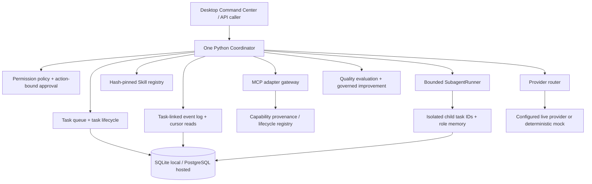

# Architecture — uneXpected v8.1 preview

The command center and runtime are one application. Roles are specifications executed as bounded sessions, not separate autonomous services. SQLite is the local backend; PostgreSQL is the hosted shared-state adapter. Provider keys remain server-side. Skills are hash-pinned context packages; their tool declarations do not grant capabilities. The MCP gateway is an in-process adapter boundary and does not open remote MCP connections. Child runs are sequential, bounded and linked to their parent task. Task event cursors retrieve persisted history without replaying work.

## v8.1 implementation boundaries

- MCP adapters must match a reviewed capability record by source, publisher, version, digest, permission scopes and data-access scopes. Calls require an enabled capability, role scope, permission authorization and bounded JSON inputs/results. In-process timeouts signal cooperative cancellation and are never retried; Python cannot forcibly stop an already-running adapter. Privileged MCP tools remain blocked until durable approval/replay is verified.
- Subagents are limited to three child requests per parent call, four steps per child, a maximum configured depth of three, explicit child inputs and bounded summaries. Parent approval does not grant child privileges.
- Task event pages use monotonically increasing event IDs. Reconnecting with a cursor reads later events; it never re-enqueues or re-invokes the task.
- Remote MCP transport, full RAG ingestion, visual trace streaming, parallel subagents and recurring schedules remain separate future gates.

## Historical notes — 7.3.0 governed workflow and capability upgrade

- Added a local hash-pinned workflow-skill registry for creative-media, skill-engineering and self-improvement context. Supplemental profiles remain outside `agents/`; the canonical registry still contains exactly 38 roles. Skill text is injected only for a mapped role and matching trigger, with a fresh SHA-256 check before provider dispatch.
- Added a provenance-aware capability registry backed by an additive SQLite table and audited lifecycle events. Records are metadata only; no external capability is executed by registry transitions. The `enabled` state requires an explicitly registered adapter verifier.
- Replaced caller-asserted approval flags with an `ApprovalVerifier` host interface and canonical action-digest binding. Privileged actions default to deny. Durable queued privileged actions remain denied until a host can persist and revalidate an approval reference.
- Bound improvement baselines and candidate evaluations to active-version, instruction and report fingerprints. Promotion now rejects stale baselines and records benchmark/scenario IDs, candidate hashes and approval state in the persisted evaluation report.
- Runtime package version is `7.3.0`. The default provider remains deterministic mock; no real provider, TAAFT adapter, external service, hosted scheduler, account integration or production approval authority is activated by this release.
- The historical v6 archive remains an optional test fixture; its integrity test is retained and skips only when that fixture is not supplied.

### Host approval and privileged actions

The `ApprovalVerifier` protocol is `verify(approval: ApprovalContext, permission: str, action_digest: str) -> bool`. The v7.3.1 package includes `GitHubPullRequestApprovalVerifier` and `approval_verifier_from_env()`, which checks GitHub-authenticated reviewer identity, current repository admin permission, the exact reviewed commit, action digest and one-use ledger. It remains disabled until the host supplies a read-only token, exact repository allowlist, trusted reviewers and durable ledger storage. With no valid verifier, privileged direct invocation, shared-knowledge approval, protected promotion and rollback fail closed. Privileged durable queue requests remain denied because this release has no durable approval-reference revalidation path.

The capability registry stores provenance and lifecycle metadata. A transition is not an external installation or execution; `enabled` requires a registered adapter verifier. The v8.1 branch includes an in-process MCP adapter gateway; no remote MCP transport, external MCP server, TAAFT service, hosted scheduler or production approval authority is configured.
