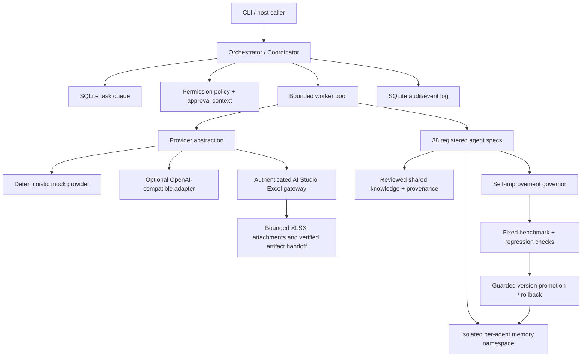

# Architecture — uneXpected v7.3.2

SQLite stores queue state, events, idempotency results, isolated agent memory, provenance-tagged shared knowledge, outcomes, proposals and version history. The provider adapter is shared; roles are specifications executed as sessions, not separate autonomous models. The default provider is deterministic mock.

## Historical notes — 7.3.0 governed workflow and capability upgrade

- Added a local hash-pinned workflow-skill registry for creative-media, skill-engineering and self-improvement context. Supplemental profiles remain outside `agents/`; the canonical registry still contains exactly 38 roles. Skill text is injected only for a mapped role and matching trigger, with a fresh SHA-256 check before provider dispatch.
- Added a provenance-aware capability registry backed by an additive SQLite table and audited lifecycle events. Records are metadata only; no external capability is executed by registry transitions. The `enabled` state requires an explicitly registered adapter verifier.
- Replaced caller-asserted approval flags with an `ApprovalVerifier` host interface and canonical action-digest binding. Privileged actions default to deny. Durable queued privileged actions remain denied until a host can persist and revalidate an approval reference.
- Bound improvement baselines and candidate evaluations to active-version, instruction and report fingerprints. Promotion now rejects stale baselines and records benchmark/scenario IDs, candidate hashes and approval state in the persisted evaluation report.
- Runtime package version is `7.3.0`. The default provider remains deterministic mock; no real provider, TAAFT adapter, external service, hosted scheduler, account integration or production approval authority is activated by this release.
- The historical v6 archive remains an optional test fixture; its integrity test is retained and skips only when that fixture is not supplied.

### Host approval and privileged actions

The `ApprovalVerifier` protocol is `verify(approval: ApprovalContext, permission: str, action_digest: str) -> bool`. The v7.3.1 package includes `GitHubPullRequestApprovalVerifier` and `approval_verifier_from_env()`, which checks GitHub-authenticated reviewer identity, current repository admin permission, the exact reviewed commit, action digest and one-use ledger. It remains disabled until the host supplies a read-only token, exact repository allowlist, trusted reviewers and durable ledger storage. With no valid verifier, privileged direct invocation, shared-knowledge approval, protected promotion and rollback fail closed. Privileged durable queue requests remain denied because this release has no durable approval-reference revalidation path.

The capability registry stores provenance and lifecycle metadata. A transition is not an external installation or execution; `enabled` requires a registered adapter verifier. No TAAFT or MCP adapter is shipped in this Python runtime.

## Excel tool boundary (v7.3.2)

The Python coordinator invokes the existing authenticated AI Studio gateway through `AIStudioGatewayProvider`. When the provider supports Excel, raw XLSX uploads are proxied to the Node `/excel/upload` route, explicit temporary file IDs are passed to `/orchestrate`, and generated artifact metadata is retained in `TaskResult.output_artifacts`. The Python API registers those artifact IDs in its own process-local allowlist before exposing the authenticated `/v1/excel/artifacts/{id}` download proxy. It never accepts an arbitrary remote gateway artifact ID for download. The Excel workflow is a reusable skill mapped to existing canonical roles; it does not add an agent process or privilege.
